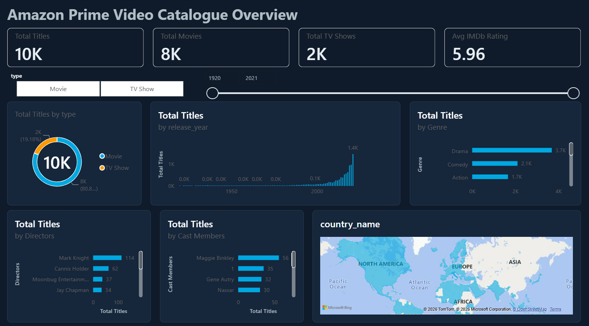

# Amazon Prime Video Catalogue Dashboard

An interactive Power BI dashboard that analyses Amazon Prime Video movies and TV shows: release years, genres, directors, cast, IMDb ratings, and where titles can stream by country.

**Author:** Thiyagarajan M S
**Tools:** Python (Google Colab), Power BI Desktop, DAX

---

## Dashboard preview



---

## What the dashboard shows

A single-page dashboard with:

- **KPI cards:** total titles, total movies, total TV shows, average IMDb rating
- **Type split:** movies vs TV shows (donut chart)
- **Release year trend:** titles by release year, with no restriction on year
- **Top genres:** top 10 genres by number of titles
- **Top directors and top cast:** top 10 by number of titles
- **Country availability:** where titles stream, shown by country
- **Slicers:** filter everything by type (movie / TV show) and release year range

---

## Data sources

| Data | Source |
|---|---|
| Catalogue (title, type, director, cast, production country, release year, duration, genre, maturity rating) | Kaggle dataset "Amazon Prime Movies and TV Shows" (snapshot) |
| IMDb rating and vote count | IMDb public datasets (`title.basics`, `title.ratings`) |
| Streaming availability by country | TMDB API (watch-provider data powered by JustWatch) |

Amazon does not provide a public catalogue API, so the catalogue comes from the Kaggle snapshot.

---

## How the data was built

All data preparation is in the Colab notebook (`[notebook file name].ipynb`).

1. **Load** the Kaggle Prime catalogue and rename columns.
2. **Clean:** split `duration` into `duration_minutes` (movies) and `seasons` (TV shows); trim text; no release-year filter is applied.
3. **Match to IMDb:** join the IMDb ratings by normalised title, release year and type (movie or TV). Unmatched titles keep a blank rating, with no invented values.
4. **Check availability:** for each title, look up TMDB (by IMDb ID first, then by title search) and collect the countries where it is available on Prime Video as a subscription (`flatrate`) service.
5. **Export** CSV tables for Power BI: one main table, bridge tables (one value per row for cast, genre, director, production country, availability country), and a country summary table.

To rerun it, open the notebook in Google Colab, run the cells in order, and paste your own TMDB v3 API key when prompted. The key is entered with `getpass` and is not saved in the notebook.

---

## Data model (Power BI)

`amazon_prime_main` is linked on `show_id` to these tables, one-to-many:

- `bridge_cast`
- `bridge_genre`
- `bridge_director`
- `bridge_production_country`
- `bridge_availability_country`

`country_availability_summary` is a standalone table used for the country map. It is not connected to the main table, so the slicers do not filter it.

### Main DAX measures

```dax
Total Titles = DISTINCTCOUNT(amazon_prime_main[show_id])
Total Movies = CALCULATE([Total Titles], amazon_prime_main[type] = "Movie")
Total TV Shows = CALCULATE([Total Titles], amazon_prime_main[type] = "TV Show")
Avg IMDb Rating = AVERAGE(amazon_prime_main[imdb_rating])
IMDb Coverage % = DIVIDE(COUNT(amazon_prime_main[imdb_rating]), COUNTROWS(amazon_prime_main))
Titles Streamable = DISTINCTCOUNT(bridge_availability_country[show_id])
```

---

## Results of the availability check

From the run used for this dashboard (a sample of 3,000 titles):

| Result | Count |
|---|---|
| Titles checked | 3,000 |
| Available on Prime Video in at least one country | 1,362 |
| No Prime subscription listing found | 413 |
| Not found on TMDB (availability unknown) | 1,225 |
| Matched to TMDB by IMDb ID | 1,155 |
| Matched to TMDB by title search | 620 |
| Countries with at least one available title | 133 |

---

## Limitations

- **The catalogue is a snapshot,** not a live feed, so it may not match Prime Video today.
- **Availability covers a sample** of the catalogue (the first 3,000 titles), not every title.
- **1,225 sampled titles could not be found on TMDB.** Their availability is unknown, which is different from "not on Prime".
- **Title-search matches (620) are less reliable** than IMDb ID matches, because a similar title may have been matched by mistake.
- **TMDB reports current availability.** Titles that have since left Prime appear as "no Prime listing".
- **IMDb ratings exist only for matched titles.** `IMDb Coverage %` shows how many titles have one.
- **Director, cast and country have missing values in the source data.** ### Missing Values Summary

| Column | Missing (%) |
|---|---:|
| production_country | 93.0 |
| tmdb_id | 81.6 |
| seasons | 80.8 |
| availability_status | 69.0 |
| match_method | 69.0 |
| imdb_votes | 54.9 |
| imdb_rating | 54.9 |
| director | 21.5 |
| duration_minutes | 19.2 |
| cast | 12.8 |
| maturity_rating | 3.5 |
| show_id | 0.0 |
| type | 0.0 |
| duration_raw | 0.0 |
| release_year | 0.0 |
| title | 0.0 |
| genre | 0.0 |
- **Production country and streaming country are different fields.** One is where a title was made, and the other is where it can be watched.

---

## Repository contents

| File | Description |
|---|---|
| `Amazon_Prime_Dashboard.pbix` | The Power BI dashboard (opens in Power BI Desktop) |
| `Data_collection.ipynb` | Colab notebook that builds the data |
| `Amazon_prime_Dataset` | The exported CSV tables |
| `Dashboard.pdf` | Static PDF export of the dashboard |
| `Dashboard.png` | Screenshot used in this README |

---

## How to open the dashboard

1. Download `Amazon_Prime_Dashboard.pbix` (open the file on GitHub and click the download icon).
2. Open it in **Power BI Desktop** (Windows).
3. If Power BI Desktop is not available, view `Dashboard.pdf` instead. The PDF is static, so the slicers do not work.

---

## Credits and attribution

- Availability data from TMDB, powered by JustWatch. This product uses the TMDB API but is not endorsed or certified by TMDB.
- Catalogue data from the Kaggle dataset "Amazon Prime Movies and TV Shows" .
- Ratings from IMDb's public datasets, used for non-commercial, educational purposes.

*This project is for educational use only.*
